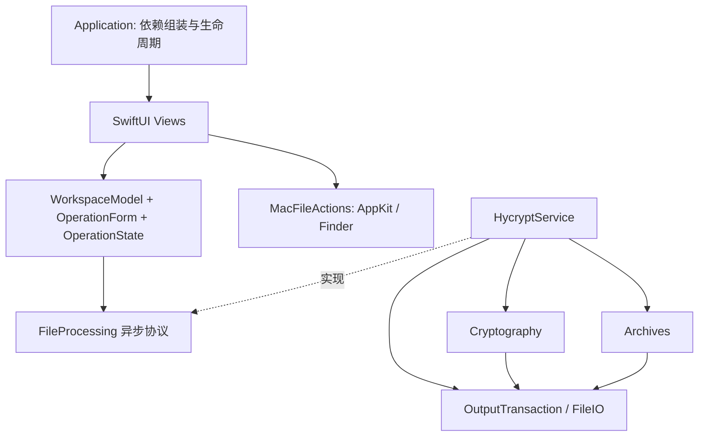

# Swift 架构

应用只有两个 Swift 模块：`HycryptApp` 管理呈现与用户操作，`HycryptCore` 提供文件处理。
CArgon2、CArgon2Shim 和 ZIPFoundation 只由 Core 使用；Shim 负责 Argon2 工作内存在任何返回路径上的清零与释放。目录用于划分职责，不为每个类型新增模块。

## 状态与视图

- `HycryptApp` 用 `@State` 拥有唯一的 `@Observable @MainActor WorkspaceModel`，显式注入 `HycryptService`。
- `OperationForm` 是值类型，只管理输入、输出命名、校验与请求构建。源文件类型在选择时读取一次；核心服务执行前会重新验证。
- `OperationState` 用枚举表示 idle、running、cancelling、succeeded、failed、cancelled，不维护可能互相矛盾的布尔量和结果字段。
- 子视图只接收使用到的值、`Binding` 和动作，拖放高亮等局部状态留在视图内。整个模型不向所有子视图传递。
- `MacFileActions` 使用异步原生文件选择窗口；模型和 Core 不导入 AppKit。菜单通过 focused scene action 调用当前工作区动作。
- 页面编辑会清除旧结果，重复点击已选模式不会重置自定义输出名。处理期间禁止重新选择输入、模式或目录；执行请求本身是不可变快照。

## 原生窗口与材质

- `NavigationSplitView` 配合 `.sidebar` 列表提供系统导航、选中状态与键盘操作。
- `.grouped` 表单组织文件、保存位置和密码，底部安全区域固定状态与操作，内容可独立滚动。
- Liquid Glass 仅用于导航与操作层；macOS 26+ 主操作使用 `GlassEffectContainer` 和系统玻璃按钮样式。
- macOS 14/15 与降低透明度模式使用标准按钮。内容区域使用系统分组表单背景，不叠加玻璃材质。
- 编译需要 Xcode 26+ SDK；最低运行版本仍为 macOS 14。

## 并发与生命周期

`FileProcessing` 是文件处理可注入的业务边界，测试注入受控实现，无需为每个底层 API 建立抽象。
`HycryptService.process` 将同步文件与 KDF 工作放进后台任务，使用 `withTaskCancellationHandler`
把调用方取消传播到该任务，并等待其退出和清理完成。原子发布已经成功时返回成功，不能把真实存在的输出误报为取消。

工作区持有一个可取消任务。任务只弱引用工作区，工作区释放时会取消任务。
进度通过 `AsyncStream.bufferingNewest(1)` 交付，防止快速文件遍历产生无限队列。
完成或取消中的状态不接受进度，操作 ID 也会拒绝旧任务的更新。

`OperationProgress.Phase` 是类型化事件，显示文案在 App 层映射。进度表示当前阶段，不能解释为整个操作的总体进度。

## 文件与加密

- `FileCipher` 只接受 V2 协议；未知或损坏的格式头直接报错，没有备用解码路径。
- `FileIO` 处理有限大小读取、普通文件验证、禁止跟随源文件符号链接、排他创建等底层操作。
- `DirectoryArchive` 与 `ZIPValidation` 不依赖加密器；ZIP 路径、CRC、条目数量及展开限制保持原行为。
- `OutputTransaction` 在目标卷的专用临时目录（不在用户所选文件夹内）暂存，并用 `RENAME_EXCL` 发布。锁失败即中止。服务用 `defer` 清理，只有完整结果才发布。网络卷上的明文 ZIP 留在本机临时目录。
- V2 字节格式与 KDF 参数保持不变。目录恢复由认证头部决定，无需用户选择恢复策略。

## 测试与维护

`Tests/HycryptCoreTests` 使用真实文件验证加密、归档、安全输出和异步取消传播。
`Tests/HycryptAppTests` 使用受控异步处理器测试状态转换、重入保护、任务释放和过期进度，直接等待任务完成，避免按时间轮询。
独立的表单测试验证输入规则。预览使用不读写文件的处理器。

`make check` 运行官方 `swift format` lint 和完整测试。格式配置只应用到项目 Swift 源码，不改第三方 C 源码。

设计依据：[Apple Observation 数据管理](https://developer.apple.com/documentation/swiftui/managing-model-data-in-your-app)、
[Task](https://developer.apple.com/documentation/swift/task)、
[取消处理](https://developer.apple.com/documentation/swift/withtaskcancellationhandler(operation:oncancel:isolation:))。

## 文本工作区

页面通过「文件 / 文本」选择输入方式，两个模式共享加密/解密导航。
`TextWorkspace` 管理文本输入、密码校验、任务与结果状态；总忙碌状态同时覆盖文件与文本任务，
用于锁定模式切换与退出保护。任务结束或取消后清除任务引用，编辑输入清除过期结果。
`TextCipher` 在后台执行 Argon2id 和 V2 认证加密，支持调用方取消传播，
使用有大小上限的内存缓冲区，不经过文件临时目录。文本使用 UTF-8，密文使用 Base64。
结果只有在完整认证、终止块、EOF 和 UTF-8 校验全部通过后才返回。

## 设置

`AppSettings` 统一持有可持久化偏好，使用可注入的 `UserDefaults` 保存稳定的输入类型标识和默认输出目录。
原生 `Settings` scene 与主窗口共享同一实例，`SettingsLink` 和系统设置菜单提供入口。
密码、原文和结果只存在于工作区中，不参与偏好持久化。
输出目录在选择文件及开始任务前解析为请求快照；运行时修改偏好不改变该快照。
任务结束后刷新下一次使用的目录，同时保留当前完成状态与结果。
主页面中的输出名称属于本次操作，可在折叠项中修改。

## Apple 平台访问控制

`LocalAuthorization` 持有可取消的系统认证会话；应用创建的新工作区直接解锁，启动不认证，锁定后重新激活才自动请求系统认证，
锁定期间整个工作区被全窗口锁定界面替代，内容与控件均不可达。`HycryptApp` 将同一实例注入
工作区，文件启动、文本处理、助记词生成和明文显示共用授权条件。系统认证采用
`LocalAuthentication`，认证结果只控制本机会话，不改变 HYCRYPT2 密文格式或密码恢复能力。
测试通过注入受控认证器覆盖失败、取消和过期回调；纯工作区测试与预览显式使用无系统认证的测试配置。

沙盒权限只允许用户选择文件读写和应用作用域书签，不包含网络权限。
`SecurityScopedAccess` 平衡授权的开始和结束；工作区任务持有自己的引用，避免设置变更提前释放运行中的权限。
默认输出目录持久化为书签，旧路径与失效书签均需重新授权。文件选择不能自动授权父目录写入。
`make security-check` 检查实际签名权限、危险权限拒绝，以及使用相同权限签名的独立探针的文件和网络访问拒绝。
